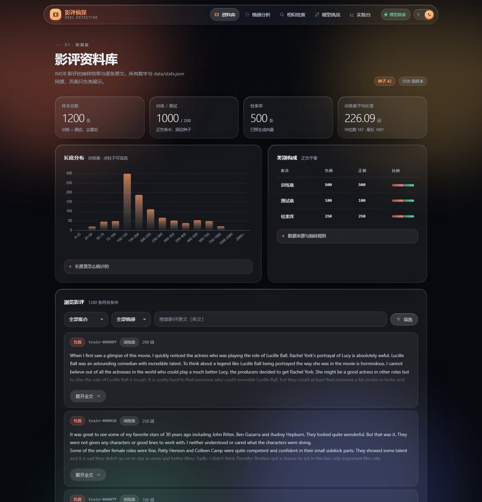
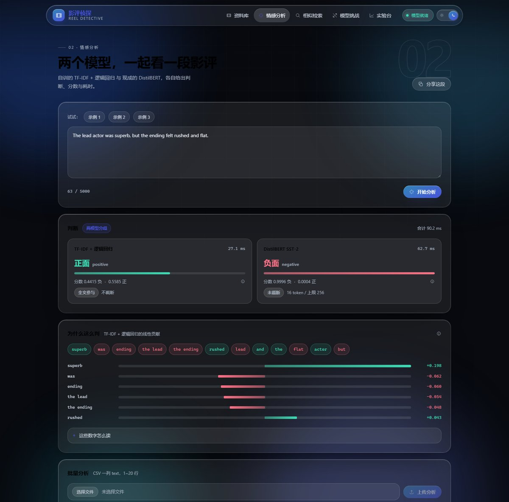
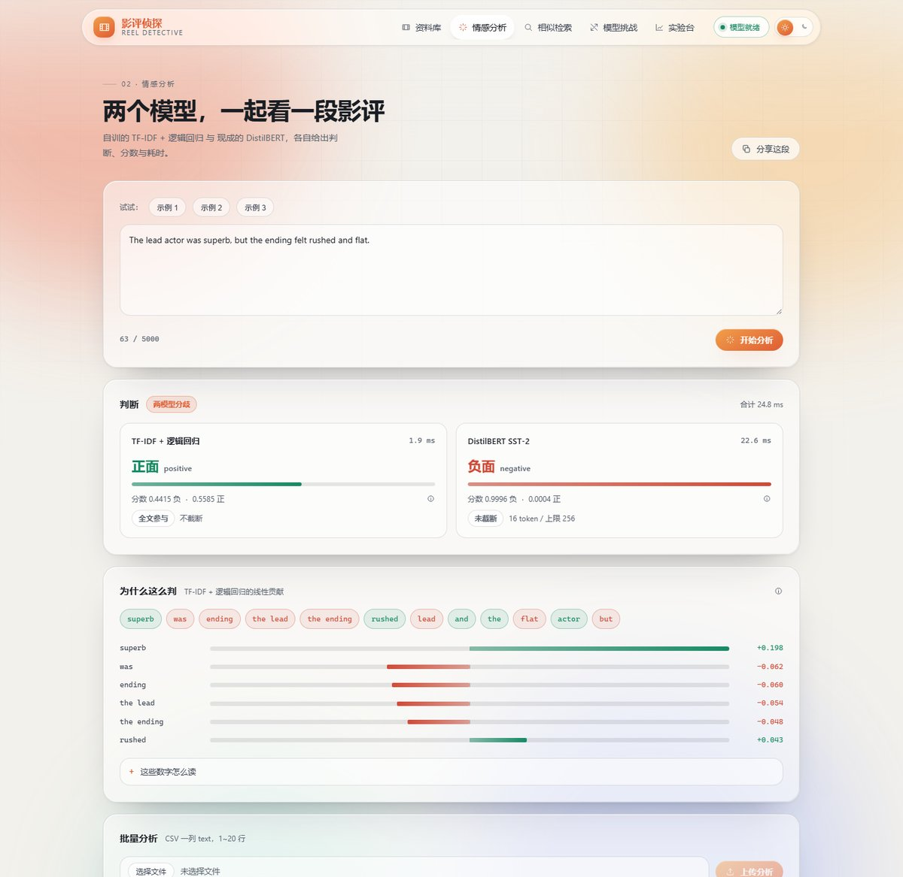
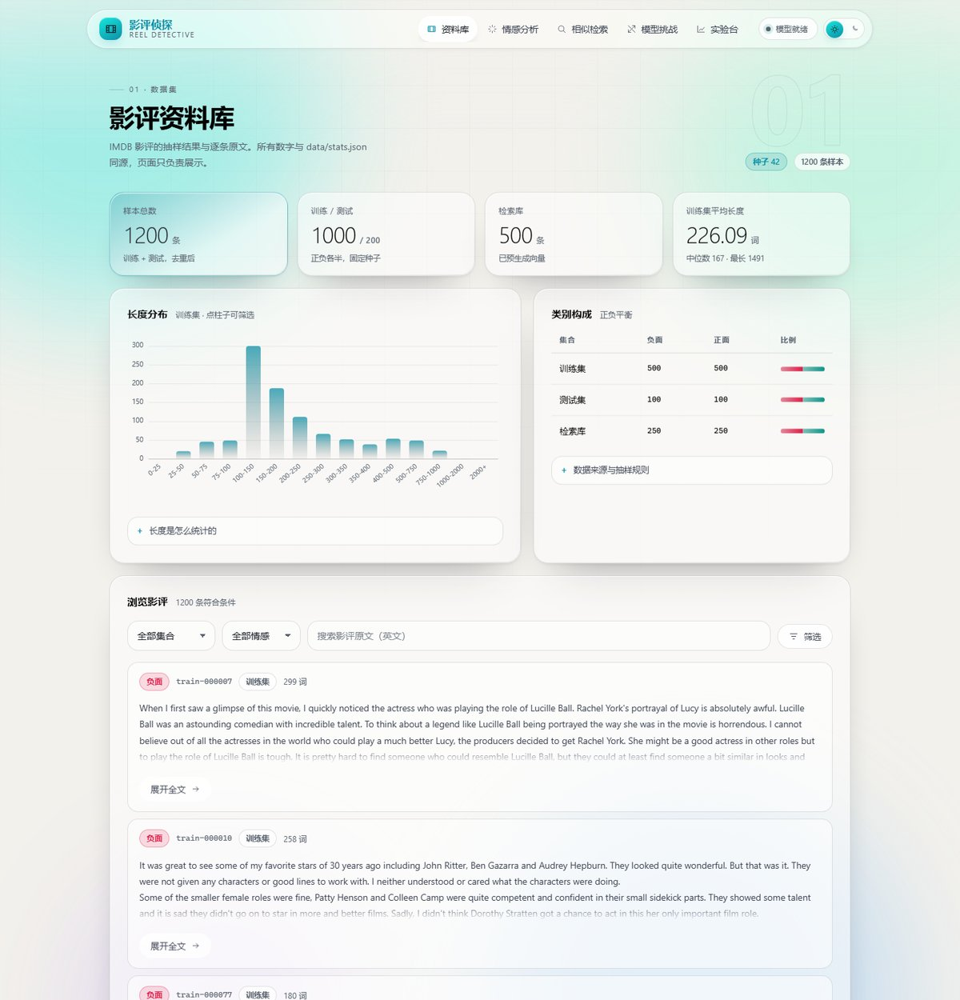
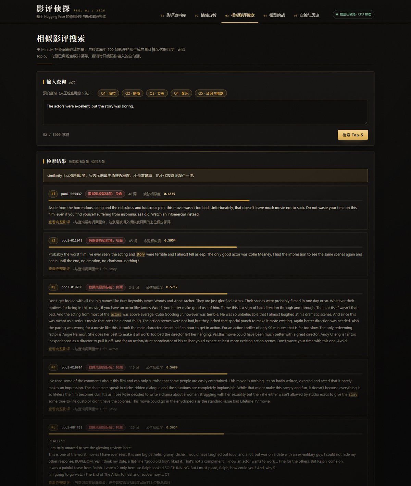
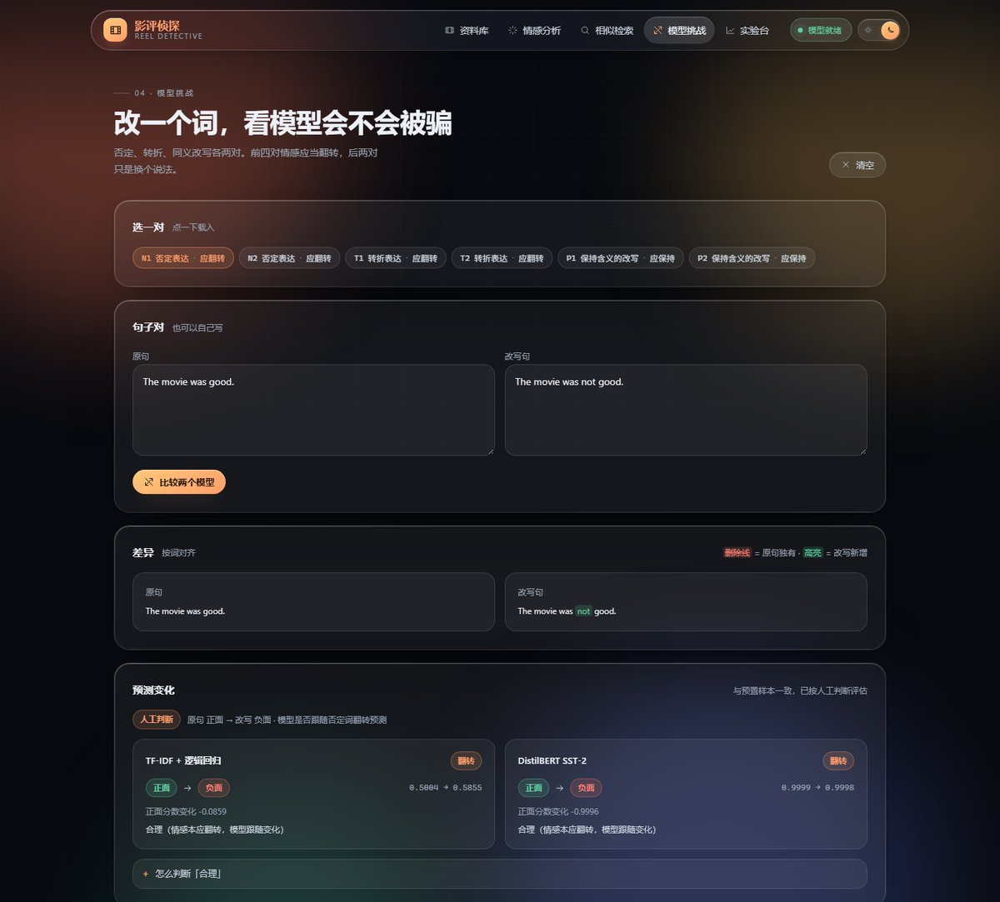
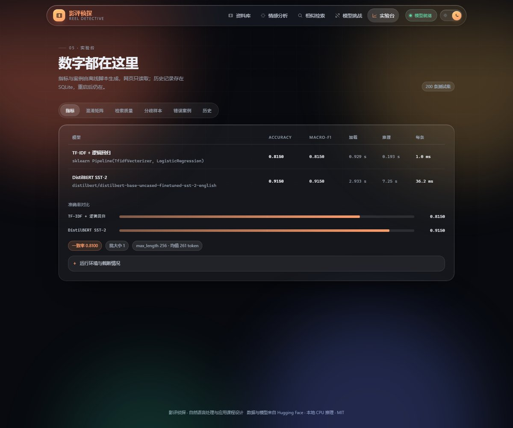

# 影评侦探 · 情感分析与相似影评检索


> movie
> 一个本地运行的中文网页系统：用两个模型判断英文影评的情感、用向量检索相似影评，并把实验指标、错误案例与操作历史都放进网页里。



---

## 目录

- [项目做了什么](#项目做了什么)
- [界面：液态玻璃与明暗双主题](#界面液态玻璃与明暗双主题)
- [任务书之外的扩展](#任务书之外的扩展)
- [五个页面](#五个页面)
- [环境要求](#环境要求)
- [快速开始（三步）](#快速开始三步)
- [两条自检命令](#两条自检命令)
- [首次运行的离线资源准备](#首次运行的离线资源准备)
- [目录结构](#目录结构)
- [接口清单](#接口清单)
- [环境变量与离线运行](#环境变量与离线运行)
- [分享给别人看](#分享给别人看)
- [实验材料在哪](#实验材料在哪)
- [评分点与文件对照](#评分点与文件对照)
- [常见问题](#常见问题)
- [依赖版本](#依赖版本)
- [说明](#说明)
- [License](#license)

---

## 项目做了什么

三件事，都跑在本机 CPU 上：

1. **情感分析**：同一段英文影评，同时交给
   - 自己训练的 `TF-IDF + 逻辑回归`（Sklearn，1000 条训练集）
   - 现成的 `distilbert-base-uncased-finetuned-sst-2-english`（只推理，不微调）

   返回两个模型各自的标签、**分类分数**和耗时，并把结果写进 SQLite 历史。

2. **相似影评检索**：用 `all-MiniLM-L6-v2` 把查询编码成 384 维向量，
   与检索库中 500 条影评的**预生成**向量算余弦相似度，返回 Top-5。

3. **模型挑战**：6 对英文句子（否定 2 对、转折 2 对、同义改写 2 对），
   看两个模型在「情感应当翻转」和「只是换说法」两种情形下是否给出了合理的预测。

> **两个数值口径，请注意区分**：
> - `score` 是模型输出的**分类分数**，不能解释为「判断正确的概率」；
> - `similarity` 是**余弦相似度**，不是准确率，也不代表影评观点一致。

## 界面：液态玻璃与明暗双主题

界面没有套用后台模板，而是一套自己写的「液态玻璃」材质系统：

- **玻璃**：面板是半透明 + `backdrop-filter` 背景模糊，边缘用一层渐变高光做出厚度感，
  背后是四团缓慢漂移的暖色光斑（`--blob-*`），光斑透过滤镜成为面板的「背光」；
- **明暗双主题**：右上角一颗滑动开关即可切换，默认跟随系统 `prefers-color-scheme`，
  选择记在 `localStorage`；也能用 URL 指定（`?theme=light`）方便分享某个主题下的画面；
- **克制的字**：页面只保留一句引导文案，长解释（口径说明、抽样规则、运行环境、案例细节）
  收进「＋」折叠块或后台的标签页里，正文不再一篇一篇地铺；
- **按钮**：胶囊形、带图标、只保留一个主操作（橘色渐变），其余都是安静的玻璃按钮。

整套样式集中在 `frontend/src/style.css`（约 1100 行），颜色全部是 CSS 变量：
改主题只改 `html[data-theme='dark']` / `html[data-theme='light']` 两组变量里的 `--accent` 等值即可。
没有引入 UI 框架，也没有外部字体或图标库（图标是自己画的 24×24 线性 SVG，见 `src/components/Icon.vue`），
断网也能完整显示。

下面是同样两个页面在两种主题下的样子：

<table>
<tr>
<td></td>
<td></td>
</tr>
<tr>
<td></td>
<td></td>
</tr>
</table>

## 任务书之外的扩展

任务书列的是最低要求，下面五项是在此基础上自己加的，**全部是真实计算，没有一处编造结果**：

| 扩展 | 怎么做的 | 为什么不算「造假」 |
|---|---|---|
| **词贡献解释** | 新增 `POST /api/explain`：用训练好的 `TfidfVectorizer` 变换输入，再乘逻辑回归的 `coef_`，得到每个词／n-gram 对这条样本的贡献值 | 数值直接来自模型参数（`TF-IDF 权重 × 回归系数`），可复算；页面明确写「不是概率，不能跨样本比较」，DistilBERT 是黑盒就不做词级归因 |
| **分歧样本浏览器** | 新增 `GET /api/divergence`：读 `predictions_test.csv`，取出测试集里两个模型意见不一致的 38 条，可按「谁判对」筛选 | 样本、标签、预测都来自已有的实验文件，文本按 `sample_id` 与 `reviews.csv` 对齐 |
| **检索命中词高亮** | 纯前端词面对齐（`frontend/src/text.js`），标出结果里与查询重合的词并计数 | 只用于解释排序线索，页面同时说明「相似度高不等于词面重合多」，排序仍由后端余弦相似度决定 |
| **长度分布联动筛选** | 点柱状图的柱子，按该分箱的词数区间筛选下方列表（后端 `GET /api/reviews` 增加 `min_words` / `max_words`） | 分箱边界来自 `stats.json` 的真实统计，筛选结果条数可核对 |
| **可分享链接** | `#/analyze?text=…`、`#/search?q=…`、`#/challenge?pair=N1`、`#/lab?tab=divergence` 打开即定位；分析页有「分享这段」按钮 | 链接只带**输入**或标签，结果仍然每次由后端实时计算，不会把结果写进链接冒充模型输出 |

## 五个页面

| 页面 | 内容 |
|---|---|
| 影评资料库 | 四块统计瓷砖、长度分布图（**点柱子联动筛选**）、正负比例条、影评卡片流（展开全文）、筛选与分页 |
| 情感分析 | 单条双模型分析（大号结论 + 分数条 + 截断提示）、**词贡献解释**、**分享这段**、CSV 批量分析与下载 |
| 相似影评搜索 | 查询框 + 5 条预设、Top-5 结果用**相似度圆环**呈现、数据集原始标签、**命中词高亮**、完整原文 |
| 模型挑战 | 6 对预置样本做成可点选胶囊、现场输入句子对、**词级差异高亮**、两个模型并排对比与合理性判断 |
| 实验台 | 六个**标签页**：指标 / 混淆矩阵 / 检索质量 / **分歧样本** / 错误案例 / 历史，避免长页面堆砌 |

<table>
<tr>
<td></td>
<td></td>
</tr>
<tr>
<td></td>
<td></td>
</tr>
</table>

---

## 环境要求

| 项目 | 要求 | 说明 |
|---|---|---|
| 操作系统 | Windows / macOS / Linux | 本项目在 Windows 11 + Python 3.12 上开发验证 |
| Python | 3.11 ~ 3.12 | 3.12.10 实测通过（`requirements.txt` 锁定了实测版本，numpy 2.5.5 需要 Python 3.11 以上） |
| Node.js | 18 以上 | **仅修改前端时需要**；仓库内已带构建好的 `frontend/dist`，只看效果可以不装 |
| 磁盘 | 约 3 GB | 依赖约 1.2 GB，模型缓存约 0.5 GB，数据集约 0.1 GB |
| 显存 | 不需要 | 全部 CPU 推理 |
| 网络 | 首次运行需要 | 下载 IMDB 数据集与三个模型权重；之后可离线 |

## 快速开始（三步）

```bash
# 1. 创建虚拟环境并安装依赖（Windows 用 .venv\Scripts\python）
git clone <你的仓库地址> movie-review-detective
cd movie-review-detective
python -m venv .venv
.venv/Scripts/python -m pip install -r requirements.txt        # Windows
# source .venv/bin/activate && pip install -r requirements.txt # macOS / Linux

# 2. 复制环境配置（Windows 网络下默认走 hf-mirror 镜像）
copy .env.example .env                                          # Windows
# cp .env.example .env                                          # macOS / Linux

# 3. 启动（一条命令同时提供接口和网页）
.venv/Scripts/python -m backend.main
```

打开 **http://127.0.0.1:8000** 就是完整网站；
接口文档在 **http://127.0.0.1:8000/docs**。

启动时会加载模型，第一次约需 15~20 秒（含下载权重），之后约 5~10 秒。
控制台会打印每个组件的加载结果：

```
[ready] dataset      0.00s  1200 条影评
[ready] tfidf        1.03s  tfidf_lr.joblib
[ready] distilbert   2.96s  distilbert/distilbert-base-uncased-finetuned-sst-2-english
[ready] embedder     9.35s  500×384 向量已加载
```

> 若仓库里没有 `data/`、`models/` 的产物（例如只克隆了代码），先按下一节跑一遍离线脚本。

## 两条自检命令

仓库里带了两个自检脚本，用来证明「网页上的数字、材料里的数字都不是手写的」。验收或答辩前跑一遍，比截图更有说服力。

```bash
# 1) 材料一致性：不启动后端，核对 CSV / JSON / 向量 / 指标能不能互相算得出来
.venv/Scripts/python scripts/09_verify_materials.py

# 2) 端到端：先在另一个终端启动服务，再跑这个，逐项验证接口、异常提示、历史增删
.venv/Scripts/python -m backend.main
.venv/Scripts/python scripts/08_smoke_test.py
```

| 脚本 | 检查什么 | 预期输出 |
|---|---|---|
| `09_verify_materials.py` | 抽样清单与原始行号、训练/测试无重叠、检索库与向量 ID 一一对应、逐条预测与测试集 ID 对齐、Accuracy / Macro-F1 / 混淆矩阵 / 一致率 / Precision@5 全部重新计算、案例引用的样本 ID 都出自测试集 | `材料一致性自检全部通过：47/47 项` |
| `08_smoke_test.py` | 四个组件就绪、统计与分页筛选、双模型单条分析、空输入/超长/缺列/超 20 条的提示、CSV 批量、Top-5 排序、6 对挑战样本、指标可读取、历史增删、重启后仍在、**词贡献与分歧样本接口**、长度区间筛选、前端与 `/docs` 可访问 | `自检全部通过：74/74 项` |

两个脚本都会在结束时自动清理自己写入的历史记录，不会污染你的历史列表；退出码 0 表示全通过。

## 首次运行的离线资源准备

**执行顺序不能颠倒**（后一步依赖前一步的产物）：

| 顺序 | 命令 | 产出 | 耗时 |
|---|---|---|---|
| 1 | `python scripts/01_build_dataset.py` | `data/reviews.csv`、`retrieval_pool.csv`、`sampling_manifest.json`、`cleaning_report.json`、`stats.json` | 首次约 1~3 分钟（下载 IMDB） |
| 2 | `python scripts/02_train_tfidf.py` | `models/tfidf_lr.joblib`、`tfidf_meta.json` | 约 1 秒 |
| 3 | `python scripts/03_verify_reload.py` | `experiments/reload_check.json` | 约 2 秒 |
| 4 | `python scripts/04_evaluate.py` | `experiments/metrics.json`、`predictions_test.csv`、`confusion_matrix.png`（报告用白底）、`confusion_matrix_dark.png`（网页用深色）、`error_cases_auto.md` | 首次约 1~2 分钟（下载 DistilBERT），之后约 10 秒 |
| 5 | `python scripts/05_build_embeddings.py` | `data/embeddings.npy`、`embeddings_ids.json`、`experiments/embedding_build.json` | 首次约 1 分钟（下载 MiniLM） |
| 6 | `python scripts/06_retrieval_check.py --emit` | `experiments/retrieval_results.csv`、`retrieval_check.csv`（待人工标注）、`retrieval_top5.md` | 约 5 秒 |
| 7 | `python scripts/07_challenge_report.py` | `experiments/challenge_results.csv`、`challenge_results.md`（6 对句子在两个模型下的输出与合理性判断） | 约 5 秒 |
| 8 | 人工填写 `experiments/retrieval_check.csv` 的 `relevant` 与 `reason` 两列（25 行） | — | — |
| 9 | `python scripts/06_retrieval_check.py --score` | `experiments/retrieval_metrics.json` | 1 秒 |
| 10 | `python report/build_report.py`（需要 `python-docx`） | `report/课程报告.docx`、`report/课程报告.md` | 约 3 秒 |

> 仓库里已经包含第 1~9 步的**全部产物**，以及人工标注完成的 `retrieval_check.csv`，
> 因此正常验收时**不需要重跑**，直接第 3 步启动即可。重跑脚本会得到一致的划分与指标
> （固定随机种子 `42`）。

## 目录结构

```
movie-review-detective/
├─ backend/                  后端（FastAPI）
│  ├─ main.py                应用入口：启动加载、路由注册、静态前端托管
│  ├─ artifacts.py           模型与数据产物的单例加载（启动一次，请求复用）
│  ├─ db.py                  SQLite 历史记录
│  ├─ schemas.py             请求模型与输入校验
│  └─ routes/
│     ├─ dataset.py          资料库统计与分页
│     ├─ predict.py          单条 / CSV 批量预测
│     ├─ search.py           相似影评检索
│     ├─ challenge.py        句子对比较
│     ├─ experiments.py      实验指标与历史
│     └─ insight.py          扩展：词贡献解释与分歧样本
├─ common/
│  ├─ config.py              路径、随机种子、配额、模型标识（全项目统一口径）
│  └─ text_clean.py          清洗与长度统计（数据集构建与接口共用）
├─ scripts/                  离线算法脚本（按编号顺序执行）
│  ├─ 01_build_dataset.py    数据获取、抽样、清洗、统计
│  ├─ 02_train_tfidf.py      TF-IDF + 逻辑回归训练
│  ├─ 03_verify_reload.py    传统模型重新加载验证
│  ├─ 04_evaluate.py         两模型统一评测
│  ├─ 05_build_embeddings.py 检索向量构建
│  ├─ 06_retrieval_check.py  检索效果人工检查与 Precision@5
│  ├─ 07_challenge_report.py 6 对挑战样本的批量分析
│  ├─ 08_smoke_test.py       端到端自检（需要后端已启动）
│  └─ 09_verify_materials.py 材料一致性自检（不需要后端）
├─ frontend/                 前端（Vue 3 + Vite + ECharts）
│  ├─ src/style.css          液态玻璃视觉系统（明暗两套主题变量 + 全部组件样式）
│  ├─ src/theme.js           明暗主题：跟随系统 / 手动切换 / ?theme= 指定
│  ├─ src/components/Icon.vue 自绘 24×24 线性图标
│  ├─ src/text.js            前端文本工具：命中词高亮、句子词级差异
│  ├─ src/views/             五个页面
│  ├─ src/api.js             统一的接口调用封装
│  └─ dist/                  构建产物（已提交，后端直接托管）
├─ data/                     数据与统计产物（含向量文件）
├─ models/                   传统模型文件
├─ experiments/              评测与实验材料
├─ docs/                     需求解析、页面截图
├─ report/                   课程报告（docx + md，build_report.py 生成）
├─ requirements.txt
├─ .env.example
├─ .gitattributes            统一换行符；数据文件按字节保存，保证跨机器可复现
├─ AI_USAGE.md               AI 辅助的范围、采纳与验证方式
├─ LICENSE                   MIT
└─ README.md
```

### 修改前端时

```bash
cd frontend
npm install --registry=https://registry.npmmirror.com   # 国内建议加镜像
npm run dev      # 开发模式，http://127.0.0.1:5173，/api 自动代理到 8000
npm run build    # 重新生成 dist，后端会自动托管新文件
```

**改配色 / 材质**：只动 `src/style.css` 顶部两组主题变量（`html[data-theme="dark"]` 与
`html[data-theme="light"]`），例如把 `--accent` 换个色相，按钮、图表、圆环、进度条会一起变；
玻璃的模糊强度在 `.glass` 的 `backdrop-filter`，环境光斑在 `.blob` 的 `background`。
没有引入 Tailwind、Element Plus 之类的 UI 框架，改起来不会有「框架样式覆盖不掉」的问题。

**加一个新主题**：在 `theme.js` 的 `VALID` 里加一个名字，再在 `style.css` 里补一组
`html[data-theme='你的名字'] { … }` 变量即可；主题开关目前是「亮 / 暗」两态，做成三态只需改
`toggleTheme`。

## 接口清单

| 方法 | 路径 | 说明 |
|---|---|---|
| GET | `/api/health` | 各组件就绪状态、版本、限制（未就绪返回 503） |
| GET | `/api/dataset/stats` | 数据集统计（直接读 `data/stats.json`） |
| GET | `/api/reviews` | 分页浏览，支持 `split`、`label`、`keyword` |
| POST | `/api/predict` | 单条影评，两个模型同时分析，写入历史 |
| POST | `/api/batch` | CSV 批量（multipart，字段 `text`，1~20 条） |
| POST | `/api/search` | 相似影评 Top-5 |
| GET | `/api/search/queries` | 5 条预设查询 |
| GET | `/api/challenge/presets` | 6 对预置样本 |
| POST | `/api/challenge` | 比较一对句子在两个模型下的输出 |
| GET | `/api/experiments` | 指标、混淆矩阵、错误案例、检索检查（`theme=light|dark` 选配色） |
| GET | `/api/experiments/confusion-matrix.png` | 混淆矩阵图（深色版，地址带 `?v=` 版本号防缓存） |
| GET | `/api/history` | 历史列表（`limit`、`offset`） |
| DELETE | `/api/history/{id}` | 删除一条历史 |
| DELETE | `/api/history` | 清空历史 |
| POST | `/api/explain` | **扩展**：TF-IDF 词贡献（哪些词推向正面／负面） |
| GET | `/api/divergence` | **扩展**：两个模型意见不一致的测试样本（可按 `winner=tfidf|distilbert` 筛选） |

`GET /api/reviews` 支持 `split`、`label`、`keyword`、`min_words`、`max_words`、`page`、`page_size`，
其中词数区间供长度分布图联动筛选使用。

**输入的异常提示**（都会返回中文说明，不会被静默吞掉）：

| 情况 | 返回 |
|---|---|
| 空输入 / 只有 HTML 标签 | 400 `影评文本为空，请填写英文影评后再试` |
| 超过 5000 字符 | 400 `影评文本超过 5000 字符上限（当前 N 个字符）…` |
| CSV 缺少 `text` 列 | 400 `CSV 缺少 text 列。当前表头：…` |
| CSV 为空 | 400 `CSV 文件为空，请上传包含 text 列的文件` |
| CSV 超过 20 条 | 400 `一次最多 20 条，当前有效行 N 条…` |
| 词数区间颠倒 | 400 `词数区间不成立：下限 … 不小于上限 …` |
| 模型未就绪 | 503 + 具体缺哪个组件 |

## 环境变量与离线运行

配置文件 `.env`（从 `.env.example` 复制）：

| 变量 | 默认 | 说明 |
|---|---|---|
| `HF_ENDPOINT` | `https://hf-mirror.com` | Hugging Face 端点。国内直连官方站会超时，必须用镜像；能直连时可留空 |
| `HF_HOME` | `.cache/huggingface` | 模型与数据集缓存目录 |
| `HOST` / `PORT` | `127.0.0.1` / `8000` | 服务地址 |
| `DATABASE_PATH` | `data/history.db` | SQLite 文件位置 |
| `RETRIEVAL_POOL_SOURCE` | `split_excluded` | 检索库取样口径，见下 |

### 三种使用 Hugging Face 的方式

1. **镜像（默认，推荐国内使用）**
   ```ini
   HF_ENDPOINT=https://hf-mirror.com
   ```
2. **官方直连**（校园网 / 有代理）
   ```ini
   HF_ENDPOINT=
   ```
3. **完全离线**：在一台能联网的机器上下载好，把整个缓存目录拷过来，然后把路径指过去
   ```ini
   HF_ENDPOINT=
   HF_HOME=D:/path/to/copied/huggingface
   ```
   代码里只用到三个标识，缓存目录结构按 `huggingface_hub` 默认即可：

   | 用途 | 标识 |
   |---|---|
   | 数据集 | `stanfordnlp/imdb` |
   | 情感模型 | `distilbert/distilbert-base-uncased-finetuned-sst-2-english` |
   | 向量模型 | `sentence-transformers/all-MiniLM-L6-v2` |

   离线时 Hugging Face 会读取缓存，不会发起下载；三个模型都已加载成功后 `/api/health` 返回 200。

### 检索库的取样口径

任务书 5.1.1 要求「从训练集中固定选取 500 条作为检索库」。本项目默认使用
`split_excluded`：从 IMDB train 中**排除**已抽作训练/测试的 1200 条之后再取 500 条，
这样检索库与训练集、测试集完全不重叠，避免「检索返回的就是训练样本」的质疑。
若要求从 1000 条训练样本里取，用：

```bash
python scripts/01_build_dataset.py --pool-source from_train_1000
```

改完需要重新执行第 1、5 步。

## 分享给别人看

默认只监听 `127.0.0.1`，**只有本机能打开**——这是任务书要求的「本地 CPU 运行」形态。想让别人看到，有三种办法：

| 方式 | 怎么做 | 适用场景 |
|---|---|---|
| **局域网**（推荐） | `.env` 里改 `HOST=0.0.0.0` 后启动，控制台会打印「已对局域网开放：http://192.168.x.x:8000」；同一 WiFi 下的电脑／手机直接打开这个地址 | 宿舍、实验室、答辩现场投屏 |
| **临时公网链接** | 先按上面启动，再另开一个终端跑 `cloudflared tunnel --url http://127.0.0.1:8000`（需先装 cloudflared），它会打印一个 `https://xxx.trycloudflare.com` 链接 | 老师不在现场时远程看一眼；关掉终端链接即失效，模型仍跑在你本机 |
| **可分享链接** | 页面上的「复制可分享链接」按钮，或直接拼 URL：`#/analyze?text=…`、`#/search?q=…`、`#/challenge?pair=N1` | 把某个具体问题发给别人，让对方点开就能复现（链接只带输入，结果仍是后端实时算） |

> 不建议把项目整体部署到云上：任务书要求本地运行，云上还要重新下载 3 个模型、
> CPU 内存吃紧，反而容易在验收时翻车。临时隧道足够用，用完即关。

## 实验材料在哪

| 材料 | 文件 |
|---|---|
| 200 条测试样本逐条预测 | `experiments/predictions_test.csv` |
| 指标、混淆矩阵数值、耗时、运行环境 | `experiments/metrics.json` |
| 混淆矩阵图 | `experiments/confusion_matrix.png`（白底，报告用）、`confusion_matrix_dark.png`（深色，网页用） |
| 错误案例分析（7 条，人工撰写） | `experiments/error_cases.md` |
| 错误与分歧样本清单（自动生成） | `experiments/error_cases_auto.md` |
| 5 条查询 × Top-5 人工判断（25 条） | `experiments/retrieval_check.csv` |
| Precision@5 计算结果 | `experiments/retrieval_metrics.json` |
| 检索 Top-5 完整原文 | `experiments/retrieval_top5.md` |
| 传统模型重载验证 | `experiments/reload_check.json` |
| 向量构建记录 | `experiments/embedding_build.json` |
| 6 对挑战样本（原句/改写/人工判断/两个模型输出） | `data/challenge_pairs.json`、`experiments/challenge_results.csv`、`experiments/challenge_results.md` |
| 抽样清单与清洗记录 | `data/sampling_manifest.json`、`data/cleaning_report.json`、`data/sampling_list.csv` |
| 课程报告 | `report/课程报告.docx`、`report/课程报告.md` |
| AI 使用说明 | `AI_USAGE.md` |
| 自检结果 | 运行 `scripts/09_verify_materials.py` 与 `scripts/08_smoke_test.py` 得到 |

**本次实测结果**（200 条测试集，CPU，批大小 1）：

| 模型 | Accuracy | Macro-F1 | 加载耗时 | 推理总耗时 | 每条耗时 |
|---|---|---|---|---|---|
| TF-IDF + 逻辑回归 | 0.8150 | 0.8150 | 0.93 s | 0.19 s | 0.97 ms |
| DistilBERT SST-2 | 0.9150 | 0.9150 | 2.93 s | 7.25 s | 36.25 ms |

两模型一致率 0.8100；都判错 8 条，意见不一致 38 条；测试集 69 条（34.5%）超过 256 token 被截断。
检索平均 Precision@5 = 0.7200。

## 评分点与文件对照

| 编号 | 指标点 | 分值 | 对应文件 / 页面 |
|---|---|---|---|
| A1 | HF 数据加载与抽样清单 | 5 | `scripts/01_build_dataset.py`、`data/sampling_manifest.json` |
| A2 | 清洗、固定划分及重叠检查 | 5 | `common/text_clean.py`、`data/cleaning_report.json` |
| A3 | 数据统计正确 | 2 | `data/stats.json`（页面同源） |
| B1 | TF-IDF + LR 训练 | 7 | `scripts/02_train_tfidf.py`、`models/tfidf_lr.joblib` |
| B2 | 传统模型重载与预测 | 4 | `scripts/03_verify_reload.py`、`experiments/reload_check.json` |
| B3 | HF 情感模型推理正确 | 7 | `backend/artifacts.py`（`HFSentiment`） |
| B4 | 截断策略与模型重复使用 | 4 | 启动单例加载 + `max_length=256`，`/api/health` 可见加载耗时 |
| C1 | 两模型 Accuracy / Macro-F1 | 5 | `scripts/04_evaluate.py`、`experiments/metrics.json`、`predictions_test.csv` |
| C2 | 混淆矩阵及耗时比较 | 3 | `experiments/confusion_matrix.png`、`metrics.json` 中 `run_config` |
| C3 | ≥5 条案例分析 | 4 | `experiments/error_cases.md`（7 条） |
| D1 | 500 条向量生成、保存、加载 | 5 | `scripts/05_build_embeddings.py`、`data/embeddings.npy`、`embeddings_ids.json` |
| D2 | 余弦排序与 Top-5 | 7 | `backend/artifacts.py` 的 `search()`、`POST /api/search` |
| D3 | 5 条查询检查及 Precision@5 | 5 | `experiments/retrieval_check.csv`、`retrieval_metrics.json` |
| E1 | 资料库统计、分页、筛选 | 4 | 影评资料库页 |
| E2 | 双模型分析、分数及耗时 | 5 | 情感分析页 |
| E3 | 检索结果、相似度及原文 | 4 | 相似影评搜索页 |
| E4 | 挑战页面及 6 对样本 | 5 | 模型挑战页、`data/challenge_pairs.json` |
| E5 | 实验展示及历史增删查 | 5 | 实验与历史页、`backend/db.py` |
| E6 | CSV 批量分析及下载 | 4 | 情感分析页（示例文件 `data/sample_batch.csv`） |
| F1 | 前后端联调及启动说明 | 7 | 本文档 + `python -m backend.main` 一条命令 + `scripts/08_smoke_test.py` 74 项自检 |
| F2 | 依赖、脚本、报告、AI 说明 | 3 | `requirements.txt`、`frontend/package.json`、`report/`、`AI_USAGE.md`、`scripts/09_verify_materials.py` |

## 常见问题

**Q：启动报 `OSError: [WinError 10061]` 或 Hugging Face 连接超时？**
A：国内直连 `huggingface.co` 会超时。确认 `.env` 里 `HF_ENDPOINT=https://hf-mirror.com`。
若使用系统代理，Hugging Face 会读取 `HTTP_PROXY`/`HTTPS_PROXY`，注意代理与镜像不要互相干扰。

**Q：`pip install` 很慢？**
A：换国内镜像，例如
`python -m pip install -r requirements.txt -i https://mirrors.ustc.edu.cn/pypi/simple/`
（实测该源约 9 MB/s，阿里云源有时会被限速到几十 KB/s。）

**Q：端口 8000 被占用？**
A：改 `.env` 里的 `PORT`，或 `set PORT=8010` 后再启动。

**Q：页面能打开但提示「模型未就绪」？**
A：看控制台里哪个组件是 `[failed]`，以及 `/api/health` 返回的 `error` 字段。
最常见原因是没跑 `scripts/02_train_tfidf.py`（缺模型文件）或没跑
`scripts/05_build_embeddings.py`（缺向量文件）。

**Q：为什么 TF-IDF 在明显的负面短句上会判错？**
A：训练集只有 1000 条，`max_features=10000` 让模型很容易过拟合（训练集准确率 0.98，测试集 0.815），
而且 `min_df=2` 会把出现次数少的词（如 `joyless`、`wastes`）直接丢掉。详见
`experiments/error_cases.md` 与报告中的「局限」一节。

**Q：`data/history.db` 要不要提交？**
A：不需要，已加入 `.gitignore`。它是运行期数据库，首次调用 `/api/predict` 会自动创建。

**Q：课程报告怎么重新生成？**
A：`.venv/Scripts/python report/build_report.py`（依赖 `python-docx`）。脚本会读 `experiments/metrics.json`
与 `data/stats.json` 里的真实数字，同时更新 `report/课程报告.docx` 和 `report/课程报告.md`，
正文控制在 8 页以内。改过指标后重跑它，报告里的数字就会跟着更新，不会出现「报告与材料对不上」。

**Q：自检脚本报连不上服务？**
A：`scripts/08_smoke_test.py` 默认连 `http://127.0.0.1:8000`。改过端口时用
`.venv/Scripts/python scripts/08_smoke_test.py --base-url http://127.0.0.1:8010`。

**Q：改了混淆矩阵的配色，网页上还是旧图？**
A：图片地址由后端带上文件修改时间（`?v=…`），正常不会读到缓存。手动重画（不重新评测）用
`.venv/Scripts/python scripts/04_evaluate.py --replot`，会同时生成白底版（报告用）和深色版（网页用）。

**Q：想要一个公网链接发给老师？**
A：见上文「分享给别人看」。局域网最快；不在同一网络就用 cloudflared 临时隧道，
链接关掉即失效，别把它当成正式部署。

**Q：主题切换记不住 / 想固定成白天？**
A：右上角开关选择会写进 `localStorage`；想固定就直接用 `.../#/library?theme=light`。
默认（没选过时）跟随系统的深色偏好，系统切换时会自动跟着变。

**Q：界面字太少，担心老师看不出工作量？**
A：指标、案例、抽样规则这些内容没有删，只是收进了「＋」折叠块和「实验台」的标签页里，
点开就是完整内容；答辩时按「实验台 → 指标 / 混淆矩阵 / 分歧样本」逐个标签演示即可。

## 依赖版本

实测环境（详细版本记录见 `experiments/metrics.json` 的 `versions` 与 `models/*_meta.json`）：

| 组件 | 版本 |
|---|---|
| Python | 3.12.10 |
| torch | 2.15.0（CPU） |
| transformers | 4.57.6 |
| datasets | 3.6.0 |
| sentence-transformers | 5.7.0 |
| scikit-learn | 1.9.1 |
| numpy | 2.5.5 |
| fastapi | 0.163.1 |
| uvicorn | 0.54.0 |
| python-docx | 1.2.0（只用于重新生成课程报告） |
| Vue | 3.5 |
| Vite | 6.4 |

## 说明

- 本项目为个人独立完成的课程设计，数据和模型均来自 Hugging Face 公开资源，
  页面上所有数字都由后端实时计算或由离线脚本生成，没有任何预写结果。
- AI 辅助的使用范围、采纳与修改情况、验证方式见 [AI_USAGE.md](AI_USAGE.md)。

## License

[MIT](LICENSE) © 2026 杨薇琳

数据集（`stanfordnlp/imdb`）与两个预训练模型（`distilbert-base-uncased-finetuned-sst-2-english`、
`all-MiniLM-L6-v2`）的版权与使用条款归各自发布方所有，本项目只按官方说明下载并推理，不再分发权重文件。
